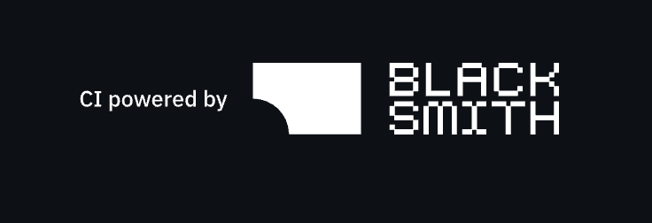
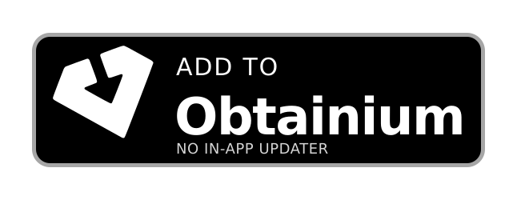
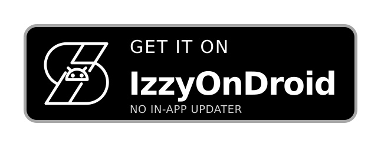
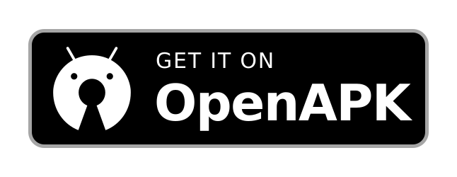
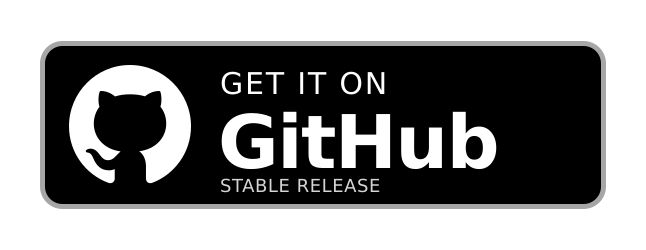

<div align="center">


# MusicPlayer

### YouTube Music client for Android

<br/>

<a href="https://www.blacksmith.sh">
  
</a>

<br/>
<br/>

[](https://github.com/SydForum/MusicPlay/releases)
[](https://github.com/SydForum/MusicPlay/blob/main/LICENSE)
[](https://github.com/SydForum/MusicPlay/releases)

<br/>

[](https://t.me/syidd_1)

<br/>

[**Download**](#download-now) · [**Features**](#features) · [**FAQ**](#faq) · [**Support**](#support-the-project)

</div>

> [!WARNING]
> # MAINTENANCE MODE
> MusicPlayer is currently in maintenance mode. This means we will only be fixing bugs and making minor improvements. Please do not submit PRs for new features or major changes, as they will not be accepted.  
> The app is **NOT** dead, please stay tuned for updates on our discord (found above).

> [!WARNING]
> **Regional Restriction** - If YouTube Music is unavailable in your region, this app will not work without a **VPN or proxy** connecting to a supported region.

---

<div align="center">

<h1><a id="screenshots"></a>Screenshots</h1>


</div>

---

<div align="center">

<h1><a id="features"></a>Features</h1>

<table>
  <tr>
    <td width="50%" valign="top">

#### Playback
- Stream any song or video from YouTube Music
- Background playback
- Download & cache for offline use
- Skip silence
- Sleep timer

</td>
    <td width="50%" valign="top">

#### Audio
- Audio normalization
- Tempo & pitch control
- Equalizer
- Crossfade

</td>
  </tr>
  <tr>
    <td width="50%" valign="top">

#### Lyrics & Discovery
- Live synced lyrics
- AI-powered lyrics translation
- Personalized quick picks
- Search songs, albums, artists, videos, and playlists

</td>
    <td width="50%" valign="top">

#### Library & Account
- Full library management
- Local playlists
- Import playlists
- Reorder songs in playlist or queue
- YouTube Music account login
- Sync songs, artists, albums, and playlists

</td>
  </tr>
  <tr>
    <td width="50%" valign="top">

#### Social
- Listen together with friends in real-time
- Last.fm integration for scrobbling
- Safe Discord Rich Presence

</td>
    <td width="50%" valign="top">

#### Interface
- Home screen widget
- Light / Dark / Black / Dynamic theme modes
- Dynamic color + 19 preset color palettes
- Built with Material 3

</td>
  </tr>
</table>

</div>

---

<div align="center">

<h1><a id="download-now"></a>Download Now</h1>

<h2>Stable Release</h2>

<table>
  <tr>
    <th align="center">Obtainium</th>
    <th align="center">IzzyOnDroid</th>
  </tr>
  <tr>
    <td align="center">
      <a href="https://apps.obtainium.imranr.dev/redirect?r=obtainium://add/https://github.com/SydForum/MusicPlay/">
        
      </a>
    </td>
    <td align="center">
      <a href="https://apt.izzysoft.de/fdroid/index/apk/com.sydforum.musicplay">
        
      </a>
    </td>
  </tr>
  <tr>
    <th align="center">OpenAPK</th>
    <th align="center">GitHub</th>
  </tr>
  <tr>
    <td align="center">
      <a href="https://www.openapk.net/musicplayer/com.sydforum.musicplay/">
        
      </a>
    </td>
    <td align="center">
      <a href="https://github.com/SydForum/MusicPlay/releases/latest/download/MusicPlayer.apk">
        
      </a>
    </td>
  </tr>
</table>

<h2>Nightly Build</h2>

<table>
  <tr>
    <th align="center">GitHub</th>
  </tr>
  <tr>
    <td align="center">
      <a href="https://github.com/SydForum/MusicPlay/releases/download/nightly/MusicPlayer-with-Google-Cast.apk">
        
      </a>
    </td>
  </tr>
</table>

</div>

---

<div align="center">

<h1><a id="faq"></a>FAQ</h1>

<h3>Got questions? Check out our <a href="https://github.com/SydForum/MusicPlay">FAQ page</a> for answers to the most common ones.</h3>

</div>

---

<div align="center">

<h1><a id="translations"></a>Translations</h1>

[](https://github.com/SydForum/MusicPlay)

<h3>We use Weblate to translate MusicPlayer. <a href="https://github.com/SydForum/MusicPlay">Help us bring MusicPlayer to more people!</a></h3>

<a href="https://github.com/SydForum/MusicPlay">
  
</a>

<h3>Thank you! Every translation makes MusicPlayer a little more accessible to someone, somewhere in the world.</h3>

</div>

---

<div align="center">

<h1><a id="support-the-project"></a>Support the Project</h1>

<h3>MusicPlayer is free and open-source. If it brings you joy, consider supporting its development!</h3>

#### Monero (XMR)


```text
44XjSELSWcgJTZiCKzjpCQWyXhokrH9RqH3rpp35FkSKi57T25hniHWHQNhLeXyFn3DDYqufmfRB1iEtENerZpJc7xJCcqt
```

#### Buy Me a Coffee

<a href="https://i.ibb.co.com/M5Bs20S9/qr-ID1025412063568-31-08-26-1788184448-1788184449100.jpg">
  
</a>

</div>

---

<div align="center">

<h1>Special Thanks</h1>

<h3>MusicPlayer stands on the shoulders of incredible open-source work.</h3>

<h3>Main Inspirations</h3>

<table>
  <thead>
    <tr>
      <th align="center">Project</th>
      <th align="center">Authors</th>
    </tr>
  </thead>
  <tbody>
    <tr>
      <td align="center"><strong>InnerTune</strong></td>
      <td align="center"><a href="https://github.com/z-huang">Zion Huang</a> · <a href="https://github.com/Malopieds">Malopieds</a></td>
    </tr>
    <tr>
      <td align="center"><strong>OuterTune</strong></td>
      <td align="center"><a href="https://github.com/DD3Boh">Davide Garberi</a> · <a href="https://github.com/mikooomich">Michael Zh</a></td>
    </tr>
  </tbody>
</table>

<h3>Libraries & Integrations</h3>

<table>
  <thead>
    <tr>
      <th align="center">Project</th>
      <th align="center">Contribution</th>
    </tr>
  </thead>
  <tbody>
    <tr>
      <td align="center"><a href="https://better-lyrics.boidu.dev"><strong>Better Lyrics</strong></a></td>
      <td>Time-synced lyrics with word-by-word highlighting & YouTube Music integration</td>
    </tr>
    <tr>
      <td align="center"><a href="https://github.com/MetrolistGroup/metroserver"><strong>metroserver</strong></a></td>
      <td>Listen-together real-time backend</td>
    </tr>
    <tr>
      <td align="center"><a href="https://github.com/aleksey-saenko/MusicRecognizer"><strong>MusicRecognizer</strong></a></td>
      <td>Music recognition feature & Shazam API integration</td>
    </tr>
    <tr>
      <td align="center"><a href="https://github.com/ZemerTeam/zemer-cipher"><strong>zemer-cipher</strong></a></td>
      <td>YouTube cipher deobfuscation and PoToken generation</td>
    </tr>
    <tr>
      <td align="center"><a href="https://www.blacksmith.sh"><strong>Blacksmith</strong></a></td>
      <td>High-performance GitHub Actions runners powering our CI</td>
    </tr>
  </tbody>
</table>

<br/>

<a href="https://www.blacksmith.sh">
  
</a>

<h3>We also thank the entire open-source community! For every library, tool, and API that powers this project.</h3>

</div>

---

<div align="center">

<h1>Contributors</h1>

<h3>This project wouldn't exist without these amazing people!</h3>

<a href="https://github.com/SydForum/MusicPlay/graphs/contributors">
  
</a>

</div>

---

<div align="center">

<h1>Disclaimer</h1>

This project is **not affiliated with, funded, authorized, endorsed by, or in any way associated** with YouTube, Google LLC, Metrolist Group LLC, or any of their affiliates and subsidiaries.

All trademarks, service marks, and intellectual property rights referenced in this project belong to their respective owners.

</div>

---

<div align="center">

<br/>

**Made with ❤️ by [SydForum](https://github.com/SydForum)**

**This project stands with Palestine 🇵🇸**

</div>

---

## Credits

MusicPlayer is a modified version of [Metrolist](https://github.com/MetrolistGroup/Metrolist) by Mo Agamy and contributors.
