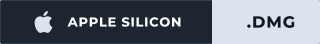
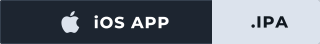

<div style="display: flex; gap: 1rem;">
  
  <div>
      <h1>Metrolist [KMP]</h1>
      <h3>A Material Design YouTube Music client for Android, iOS and desktop</h3>
      <div style="display: flex; gap: 1rem;">
        <a href="https://github.com/MetrolistGroup/Metrolist/releases"></a>
        <a href="https://github.com/MetrolistGroup/Metrolist/blob/main/LICENSE"></a>
        <a href="https://github.com/MetrolistGroup/Metrolist/releases"></a>
      </div>
  </div>
</div>

<br>

<div style="display: flex; gap: 0.5rem; align-items: center;">
  <a href="https://www.blacksmith.sh"></a>
  <a href="https://dsc.gg/metrolist"></a>
  <a href="https://t.me/metrolistapp"></a>
</div>

<br>

> [!WARNING]
> <details>
>   <summary>The use of Metrolist to access YouTube Music may violate YouTube's Terms of Service.</summary>
>   <p>You use Metrolist at your own risk. You are solely responsible for any consequences. Metrolist's contributors are not liable for damages, claims or actions against your account. We have received no reports of bans or restrictions for using Metrolist, but that does not guarantee your account's safety.</p>
> </details>
>
> YouTube Music is region-restricted. If the service is unavailable in your region, you need a [VPN or proxy in a supported region](https://one.one.one.one/) to use the app. [Changing your DNS](https://developers.cloudflare.com/1.1.1.1/setup/) can bypass some blocks.

<!---

DO NOT REMOVE THIS SECTION, I WANT TO ADD IT LATER!!!
---
<div align="center">

<h1><a id="screenshots"></a>Screenshots</h1>


</div>
-->

<div align="center">
<h1>Features</h1>
</div>

- YouTube Music playback with or without signing in
- Android 7+, iOS 17+, Windows 10+, macOS 15+ and Linux support
- Material 3 Expressive design
- Discord Rich Presence and scrobbling through Last.fm and ListenBrainz
- No ads
- Listen Together for shared playback online
- Casting to Google Cast, F-Cast and SONOS devices, and over DLNA (Android and desktop)
- Backup and playlist imports from 30+ clients and 6 services
- Music recognition through Shazam
- Lyrics with translation and romanization
- Translations in over 15 languages
- Video playback (Android and desktop)
- Content filters for AI-generated content, explicit-only playback and SFW-only playback
- Canvas from Apple Music, Spotify and YouTube Music
- Player, thumbnail, miniplayer and background styles
- Custom fonts and app icons

> [!TIP]
> <p>See the <a href="https://metrolist.cc/#faq">FAQ</a> for common questions.</p>

<br>

<div align="center">

<h1><a id="download-now"></a>Download now</h1>

<p>Install Metrolist KMP: <a href="docs/install/android.md">Android</a>, <a href="docs/install/ios.md">iOS</a>, <a href="docs/install/windows.md">Windows</a>, <a href="docs/install/macos.md">macOS</a> or <a href="docs/install/linux.md">Linux</a>. Check <a href="docs/install/README.md#get-the-package">KMP download availability</a> before choosing a package.</p>

<p>
  <a href="https://github.com/MetrolistGroup/Metrolist/releases/latest">Choose a KMP release for your device</a>
</p>

<table>
  <tr>
    <td align="center" valign="top" width="33%">
      <h2>Windows</h2>
      <p>Windows 10+ · pick your chip</p>
      <p><sub>x64 · installer and portable</sub></p>
      <p>
        <a href="https://github.com/MetrolistGroup/Metrolist/releases/latest">
          
        </a>
      </p>
      <p>
        <a href="https://github.com/MetrolistGroup/Metrolist/releases/latest/download/Metrolist-Desktop-windows.zip"></a>
      </p>
      <p><sub>ARM64 · portable only</sub></p>
      <p>
        <a href="https://github.com/MetrolistGroup/Metrolist/releases/latest"></a>
      </p>
    </td>
    <td align="center" valign="top" width="33%">
      <h2>macOS</h2>
      <p>macOS 15+ · pick your chip</p>
      <p>
        <a href="https://github.com/MetrolistGroup/Metrolist/releases/latest">
          
        </a>
      </p>
      <p>
        <a href="https://github.com/MetrolistGroup/Metrolist/releases/latest">
          
        </a>
      </p>
      <p><sub>Unsigned app, you need to trust it first</sub></p>
    </td>
    <td align="center" valign="top" width="33%">
      <h2>iOS</h2>
      <p>iPhone &amp; iPad · iOS 17+</p>
      <p>
        <a href="https://github.com/MetrolistGroup/Metrolist/releases/latest/download/Metrolist.ipa">
          
        </a>
      </p>
      <p><sub>AltStore, SideStore, TrollStore or Sideloadly</sub></p>
    </td>
  </tr>
  <tr>
    <td align="center" valign="top" width="33%">
      <h2>Android</h2>
      <p>Android 7+</p>
      <p>
        <a href="https://github.com/MetrolistGroup/Metrolist/releases/latest/download/Metrolist.apk">
          
        </a>
      </p>
    </td>
    <td align="center" valign="top" width="33%">
      <h2>Linux</h2>
      <p>glibc · pick your chip</p>
      <p><sub>x86_64 · AppImage or packages</sub></p>
      <p>
        <a href="https://github.com/MetrolistGroup/Metrolist/releases/latest"></a>
      </p>
      <p>
        <a href="https://aur.archlinux.org/packages/metrolist-bin"></a>
      </p>
      <p>
        <a href="https://github.com/MetrolistGroup/Metrolist#nix"></a>
      </p>
      <p><sub>ARM64 · AppImage only</sub></p>
      <p>
        <a href="https://github.com/MetrolistGroup/Metrolist/releases/latest"></a>
      </p>
    </td>
    <td align="center" valign="top" width="33%">
      <h2>Android stores</h2>
      <p>The app already has a built-in updater.</p>
      <p>
        <a href="https://apps.obtainium.imranr.dev/redirect?r=obtainium://add/https://github.com/MetrolistGroup/Metrolist/">
          
        </a>
      </p>
      <p>
        <a href="https://apt.izzysoft.de/fdroid/index/apk/com.metrolist.music">
          
        </a>
      </p>
      <p>
        <a href="https://www.openapk.net/metrolist/com.metrolist.music/">
          
        </a>
      </p>
    </td>
  </tr>
</table>

</div>

<br>

<div align="center">

<h1><a id="support-the-project"></a>Support the project</h1>

Metrolist is free and open-source. Donations support its development.

<p>
  <a href="https://github.com/sponsors/nyxiereal">
    
  </a>
  <a href="https://www.buymeacoffee.com/mostafaalagamy">
    
  </a>
  <a href="https://github.com/sponsors/l6t9">
    
  </a>
  <a href="https://github.com/sponsors/adrielggmotion">
    
  </a>
</p>

<details>
  <summary>Donate Monero to Mostafa Alagamy</summary>
  <p>
    
  </p>

```text
44XjSELSWcgJTZiCKzjpCQWyXhokrH9RqH3rpp35FkSKi57T25hniHWHQNhLeXyFn3DDYqufmfRB1iEtENerZpJc7xJCcqt
```

</details>
</div>

<br>

<div align="center">

<h1>Special thanks</h1>

Metrolist uses these projects and services.

<table>
  <thead>
    <tr>
      <th align="center">Project</th>
      <th align="center">Contribution</th>
    </tr>
  </thead>
  <tbody>
    <tr>
      <td align="center"><a href="https://github.com/aleksey-saenko/MusicRecognizer">MusicRecognizer</a></td>
      <td>Music recognition through the Shazam API</td>
    </tr>
    <tr>
      <td align="center"><a href="https://github.com/MetrolistGroup/innertubex">InnerTubeX</a></td>
      <td>YouTube streaming engine, developed with help from <a href="https://github.com/ZemerTeam/">ZemerTeam</a></td>
    </tr>
    <tr>
      <td align="center">Lyprio</td>
      <td>Lyrics provider</td>
    </tr>
    <tr>
      <td align="center"><a href="https://github.com/MetrolistGroup/metroserver">metroserver</a></td>
      <td>Listen Together real-time synchronization backend</td>
    </tr>
    <tr>
      <td align="center"><a href="https://www.blacksmith.sh">Blacksmith</a></td>
      <td>GitHub Actions runners for CI</td>
    </tr>
  </tbody>
</table>
</div>

<br>

<div align="center">

<h1><a id="translations"></a>Translations</h1>

[](https://hosted.weblate.org/engage/metrolist/)

<p>We use Weblate to translate Metrolist. <a href="https://hosted.weblate.org/projects/Metrolist/">Contribute a translation</a>.</p>

<a href="https://hosted.weblate.org/projects/Metrolist/">
  
</a>
</div>

<br>

<div align="center">
<h1>Contributors</h1>
<p>To contribute code, start with the <a href="docs/README.md">developer docs</a>.</p>
<a href="https://github.com/MetrolistGroup/Metrolist/graphs/contributors">
  
</a>
</div>

<br>

> [!WARNING]
> <h2>Legal disclaimer</h2>
> <p>This project is not affiliated with, funded, authorized or endorsed by YouTube, Google LLC, MetroList MLS, or their affiliates and subsidiaries.</p>
>
> <p>All trademarks, service marks, and intellectual property rights referenced in this project belong to their respective owners.</p>

<br/>

<div align="center">

**Developed by [the Metrolist development team](https://github.com/MetrolistGroup)**

**This project stands with Palestine 🇵🇸**

</div>
